# Divinity Original Sin 2 Mobile

**Divinity Original Sin 2 Mobile is an as-native-as-it-gets Android port of Divinity: Original Sin 2 – Definitive Edition
for Nintendo Switch.** The game's original AArch64 code runs on the phone's CPU (no emulator, no JIT); a small host
stands in for the Switch system services (HLE of the `nn::` SDK, 9.3), but since **0.3.0** the engine draws through the
port's **own Vulkan renderer** — no NVN, no Switch graphics API, no translation layer. Built on
[d2r-mobile](https://github.com/jhaizhou-ops/d2r-mobile) (MIT) and my other ports: DOOM Mobile, Diablo III Mobile and
Torchlight II Mobile.

**The game is not in this repository.** You need your own copy of Divinity: Original Sin 2 for Switch (base + update
v786432) and your own keys.

Русский: [ниже](#по-русски).

**Install:** step-by-step guide for players — [docs/INSTALL.md](docs/INSTALL.md) (English) ·
[docs/INSTALL.ru.md](docs/INSTALL.ru.md) (по-русски). In short: dump your own game + update v786432 and `prod.keys`, put
them into `put-game-files-here/`, double-click `setup.bat` (or `bash setup.sh`), copy `work/DivinityOriginalSin2Mobile`
to the phone's `Download` folder and install the APK from the
[Releases page](https://github.com/Desm0nt/divinity-original-sin-2-port/releases/latest) (or build it with `build.bat`,
see *Building*). Only the Switch game is needed: nothing from the iPad / PC editions.

> [!WARNING]
> **Tested on one device only: Snapdragon 8 Gen 3 / Adreno 750 (Xiaomi 14 Ultra).** Phones with **Mali** (Exynos,
> Dimensity, Tensor), **PowerVR** and **Xclipse** GPUs were only run in a limited simulation on my phone, not on real
> hardware: the renderer has paths and workarounds for them, but bugs may pop up. If something doesn't work,
> [open an issue](https://github.com/Desm0nt/divinity-original-sin-2-port/issues) and **be sure to attach the logs** —
> the whole folder `Download/DivinityOriginalSin2Mobile/logs/`: `crash.txt` (appears at the start after a crash),
> `boot.log` / `boot.prev.log` and `logcat.txt` / `logcat.prev.txt` (written on the fly, so they survive even when the
> system killed the game) — and name your phone model and Android version.

## What's new in 0.3.0

- **A fully native Android game.** Finally managed to rip out the last pieces of the Switch graphics pipeline: no more
  NVN through the Switch API, no translator layer, no conversions. Now the engine's render requests knock straight on
  our own Vulkan renderer, which talks to the phone's hardware directly.

- **A renderer tuned for phones.** Fewer render passes, and longer ones (a lot is drawn in a single pass), which
  noticeably took the load off the memory bus; shadows and the interface got much cheaper; the render work is spread
  across the CPU cores. On my phone, the same scene at the same clocks: **61.8 fps in 0.2.x → 74.5 fps with the native
  renderer in 0.3.0**.

- **Faster loading.** Got rid of needless save and profile backups at start, and the memory clean-up manager, which ate a
  lot of time while a level loaded on phones, works much better now.

- **Three interface modes to choose from.** The default is **Hybrid of touch and gamepad**; to change it: ⚙ →
  *Settings* → *Controls* → *Interface in the game*, then restart the game.
  
  - **Switch** — the plain console interface with the on-screen gamepad, taps on the game do nothing (for playing with a
    gamepad);
  - **Hybrid** (default) — the console interface with bits of the touch UI and touch support (as in 0.2.0);
  - **Touch interface** — like the iOS version: no on-screen gamepad or other extra buttons. A mobile-oriented HUD fully
    adapted to playing with your fingers on the touchscreen (unless I screwed up somewhere).

> [!WARNING]
> If the new renderer doesn't start on your device and crashes, the game automatically switches back to the old Switch
> renderer with translation.

## Screenshots

Captured on the phone (Xiaomi 14 Ultra, Adreno 750, Mesa Turnip) at the screen's 20:9 shape (wider view, nothing
stretched). The counter in the top-left corner is the port's own FPS / frame time overlay (it can be turned off). Game
text in Russian.

**0.3.0, Touch interface mode:**

|                                                                                          |                                                                                                       |
| ---------------------------------------------------------------------------------------- | ----------------------------------------------------------------------------------------------------- |
| 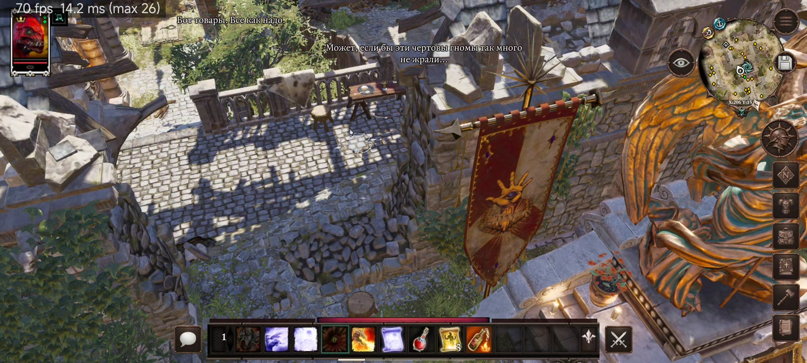      | 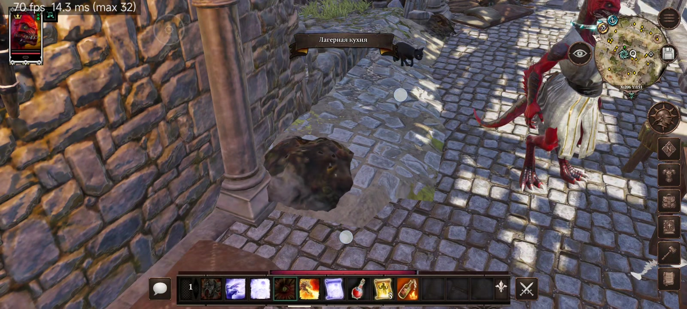                         |
| 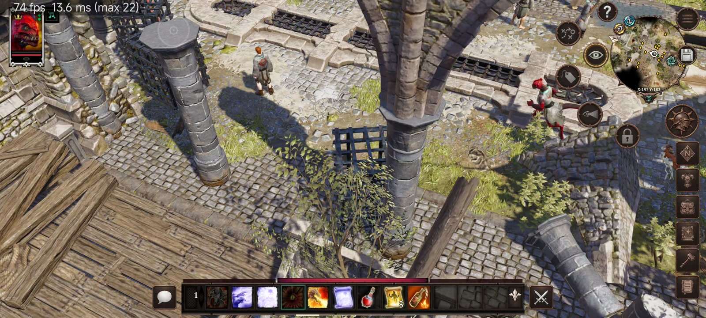    | 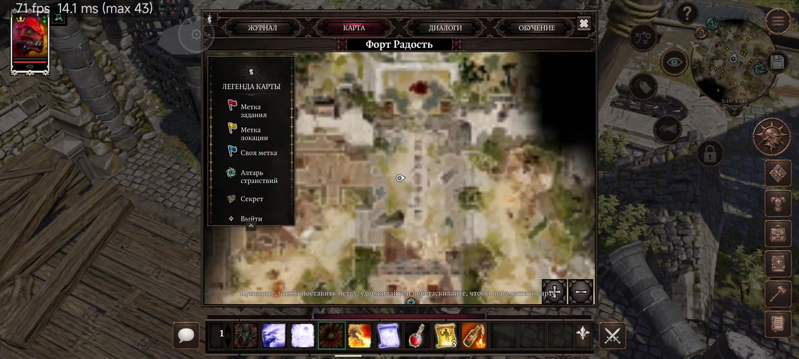                                |
| 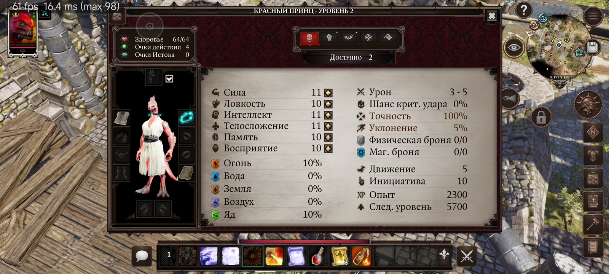             | 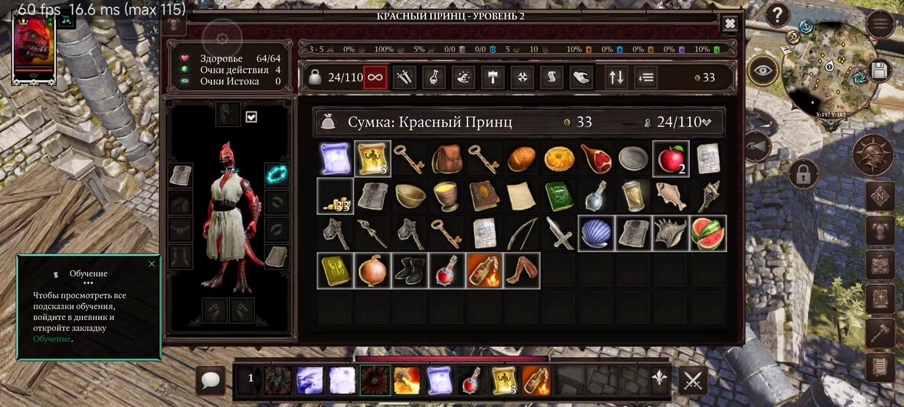   |
| 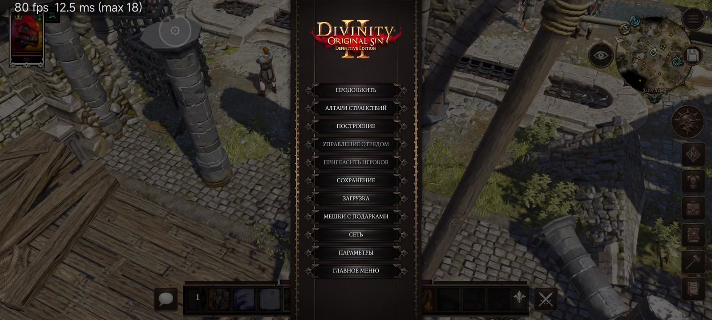 | 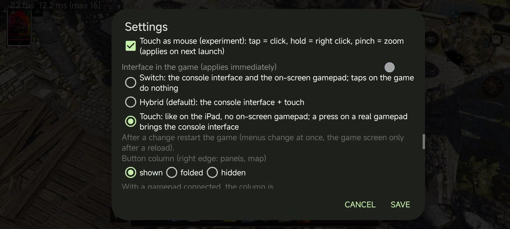 |

**Earlier builds, console interface with touch (Hybrid mode) and the on-screen pad:**

|                                                                                                      |                                                                                                          |
| ---------------------------------------------------------------------------------------------------- | -------------------------------------------------------------------------------------------------------- |
| 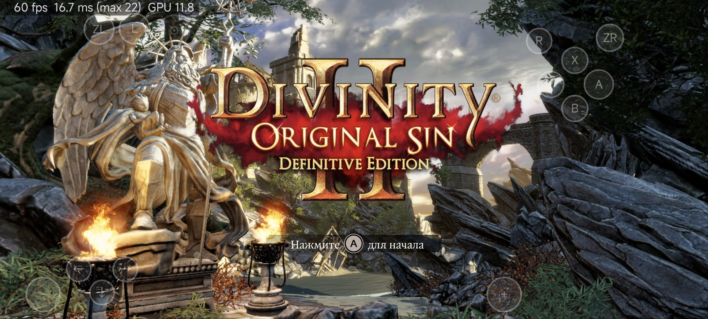                                  | 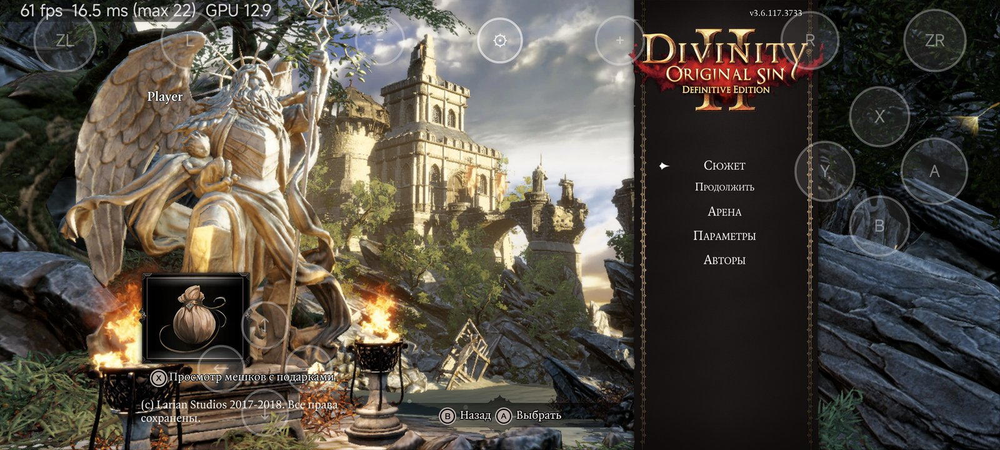                                     |
| 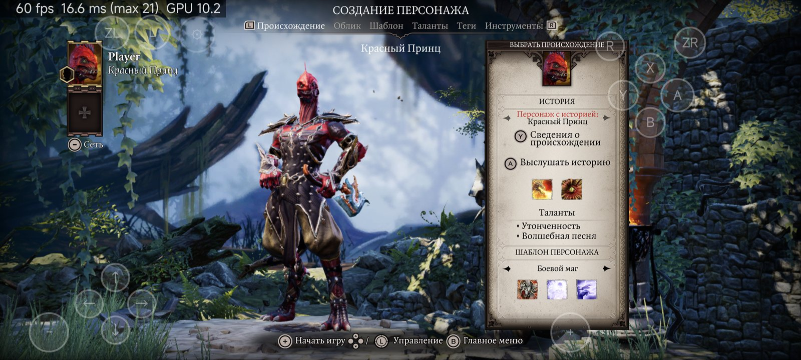               | 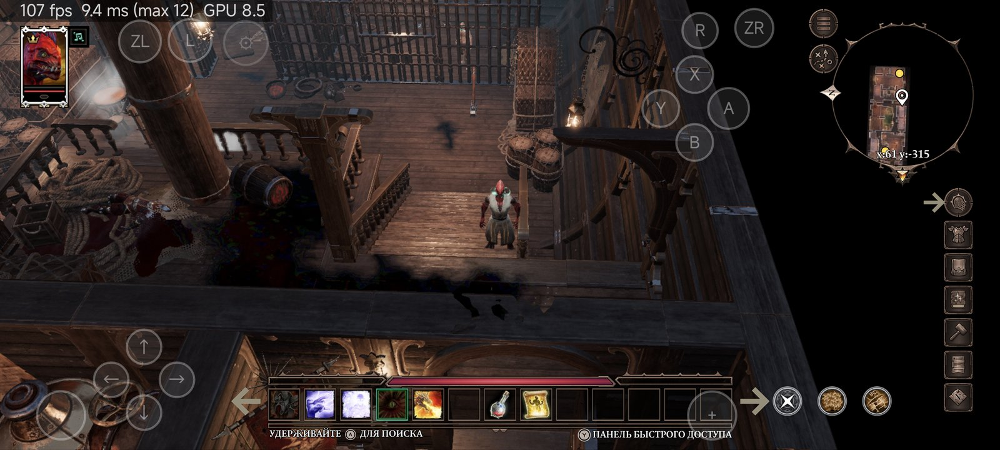 |
| 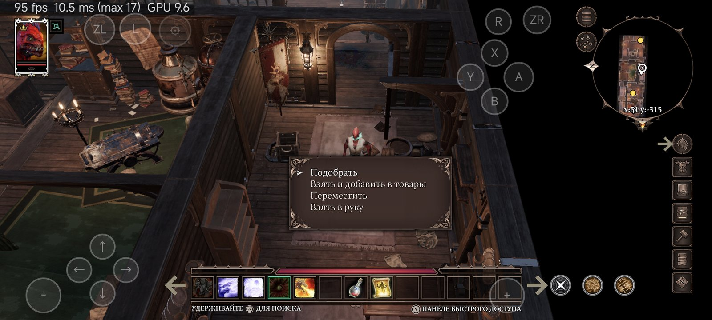 | 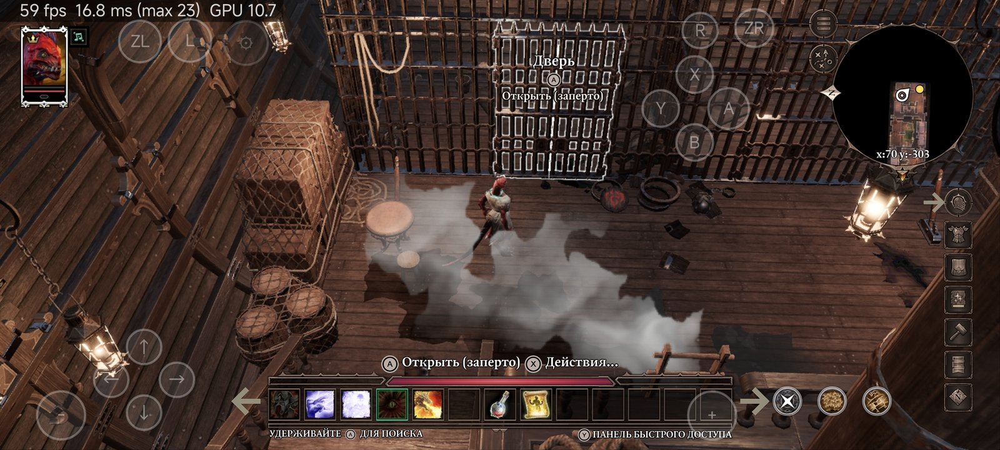                    |
| 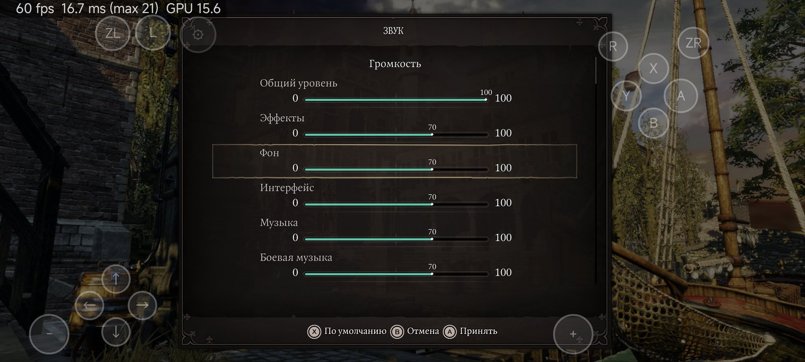                      | 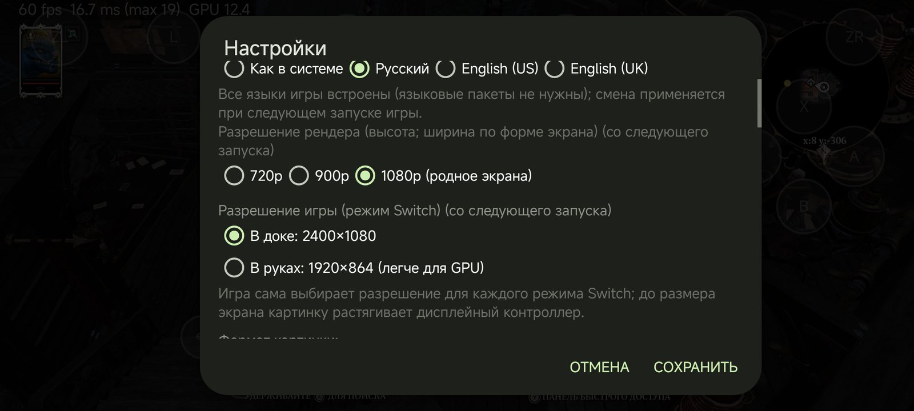                      |

## What it is, and what it is not

**It is:**

- The original game code, **executing natively** on the phone — no emulated CPU, no JIT. Switch and Android phones
  share the AArch64 instruction set; an offline rewriter (`dm/tools/patch_nso.py`) changes only the few instructions
  that cannot run unchanged on Linux (x18 use, TLS reads, system calls, counter reads) into calls to the host, and
  `dm/verify/equiv.py` checks every rewritten site against the original instruction before you play.
- An HLE host for the Horizon OS services Divinity: Original Sin 2 uses (SDK **9.3.0**: file system, audio, input, account, save data…), and **a Vulkan renderer of its own**
  (`dm/gfx/vkn`) that receives the engine's render commands directly. The game's 12 329 shaders (Larian's `.bshd`
  programs and the ones built into the program) are translated to SPIR-V offline on your PC.
- A phone port with **three interface modes** (console, hybrid, touch), a widescreen picture at the screen's own
  resolution, frame rates above 60, game controllers.

**It is not:**

- An emulator, cloud gaming or streaming.
- **A source of game content.** There is no game program, data, shader, text, art or key in this repository, and the
  APK contains none. You dump the game from a Switch you own and convert it on your PC
  ([docs/dos2/GAME_FILES.md](docs/dos2/GAME_FILES.md)). What the repository knows about the game (patch addresses,
  structure offsets, format descriptions…) is listed in [docs/dos2/DERIVED.md](docs/dos2/DERIVED.md).
- Online. Multiplayer and Steam cross-save answer like a console without a connection (answer *No* when the game offers
  cross-save); the game plays single player with local saves.
- Affiliated with Larian Studios or Nintendo.

## Features

### Three interface modes

**Hybrid is the default.** To change it: gear button (⚙) → *Settings* → *Controls* → *Interface in the game*, then
restart the game.

| Mode                 | For                         | What you get                                                                                                                                   |
| -------------------- | --------------------------- | ---------------------------------------------------------------------------------------------------------------------------------------------- |
| **Switch**           | a gamepad (Bluetooth / USB) | the console interface and the on-screen pad; taps on the game do nothing                                                                       |
| **Hybrid** (default) | touch + on-screen pad       | the console interface with touch handling, as in 0.2 (details below)                                                                           |
| **Touch**            | touch only                  | like the iPad edition: no on-screen pad, the HUD and the windows made for fingers; a press on a real gamepad brings the console interface back |

### Native renderer

The Switch build of the game is written for a desktop-class console GPU: many render passes, fat G-buffers, reading back
what was just drawn. Phone GPUs prefer the opposite: few long passes that stay in their small fast on-chip memory, and as
little traffic through the shared RAM as possible (every byte costs power and heat). In 0.3.0 the renderer is our own, so
it can draw the game's frame the way a phone likes:

- **Straight to Vulkan.** The engine's render commands go directly into the port's renderer — the ~1 000 NVN calls a
  frame that were left in 0.2.x and the whole translation step are gone. The Vulkan work is recorded on a separate
  thread while the game prepares the next frame, so the work is spread over several CPU cores.
- **Lighting in one pass.** G-buffer → depth → shadows → lighting runs as one render pass in on-chip memory on tile GPUs
  (Mali, PowerVR, and Adreno as well), and results nobody reads later are not written out to RAM at all. Together with the
  other pass work this roughly halves the memory traffic of a frame on the Mali model.
- **Cheaper shadows.** A shadow cascade that only moved a bit is shifted and only its new strip is drawn; objects outside
  a cascade are left out; a cascade where nothing changed is reused; the far cascade (distant shadows) is redrawn every
  other frame — not visible in play, about +11 % FPS while walking.
- **Less double work.** Objects whose depth is drawn again by the G-buffer anyway skip the depth pre-pass; animated
  characters are skinned once per frame for all passes.
- **Cheaper interface.** The UI is drawn in a few long passes instead of ~50 short ones, and the blurred panel
  backgrounds are drawn once and reused while nothing under them changes.
- **Textures:** phones without BC (Mali, PowerVR, Xclipse) read the ASTC pack setup makes, and whatever it lacks is
  converted on the GPU instead of the CPU. A pipeline warm-up list in the APK builds most GPU pipelines before you need
  them, so first visits stutter less.

The result on the test phone (Xiaomi 14 Ultra, standing in a busy spot of Fort Joy, frame limit off, same clock caps):
**61.8 FPS with the 0.2.x path → 74.5 FPS with the native renderer on 0.3.0**

### Picture

- **Widescreen (Hor+)**: the game renders in the screen's own shape (e.g. 2400×1080 on a 20:9 phone) with a wider view
  of the world, the HUD at the screen edges.
- **Resolution:** the window follows the Switch mode (Docked = the screen's own resolution, Handheld = lighter); the
  **3D resolution** is set per mode: a fixed 100 / 83 / 75 / 67 / 50 % or **dynamic** (the game's own DRS with a target of
  30 / 45 / 60 / 75 / 90 / 120 fps and a lowest size of 85 / 75 / 60 / 50 %; the default in Handheld), with **FSR 1**
  upscaling below 100 %, applied at once. The interface always stays at full resolution.
- **Graphics quality** page (Off / Light / Medium / Maximum / Custom): bloom, anti-aliasing, shadow maps and filter,
  distant shadows, texture sharpness, angle filtering, model detail distance, lamps per spot.
- **Frame rate limit 30 / 60 (default) / 90 / 120 / no limit** (90 and 120 only where the screen has such a mode; above
  60 means more heat). The game's speed does not change with the frame rate.

## What to expect, and how to set it up

- **I'm not a wizard, and miracles don't happen.** A phone weaker than the Switch won't run the game better than the
  Switch. A Switch-level phone at similar settings (lower resolution, 30 fps, dynamic resolution) will run about like the
  Switch. High resolution and 60+ fps need a noticeably more powerful phone.
- **The game will heat your phone.** The port is optimised (God knows, very optimised), but this is a big, heavy
  PC-class game, and it runs all CPU cores and the GPU flat out. The phone heats up, the battery drains. Nothing to be
  done about it — cap the fps, lower the resolution, play on devices with cooling, and you'll be happy.
- **When the phone overheats, fps drops, and that's expected.** Android lowers the CPU and GPU clocks, and the frame rate
  drops along with them.

**Recommended setup (⚙):**

1. *Interface in the game*: **Touch** if you play with your fingers only, **Hybrid** if you like the on-screen gamepad,
   **Switch** only with a gamepad (real or on-screen).
2. *3D resolution*: **Dynamic**, target **60 fps**, lowest **75 %** (on weak devices 60 or 50 %). Lowering the 3D
   resolution helps way more than anything else (85 % instead of 100 % gave almost +20 fps on my phone).
3. **FSR 1** — at lowered resolutions better turn it on together with sharpening. Not perfect, but it gets rid of the
   jaggies and adds some crispness. With dynamic resolution its switches become less noticeable.
4. *Frame rate limit*: **60**; weak phones — **30**.
5. Only if that's still not enough — the **Graphics quality** page (Light / Medium, or single items: shadows, bloom,
   model detail distance). But honestly, it doesn't do much.

## Current state

Tested on **Snapdragon 8 Gen 3 / Adreno 750** (Xiaomi 14 Ultra) with Mesa Turnip.

- The campaign plays from the start: the ship and Fort Joy, at 60 FPS with the default settings; with the
  higher limits above 60 where the GPU and the phone's temperature allow.
- All three interface modes, widescreen, the pause menu and the settings as described above.

### Known limitations

- Only update **v786432** is supported; the patches and addresses are tied to its build id (`main` 4979b200…,
  `sdk` 230994ac…).
- The first time a scene is shown some Vulkan pipelines may still be built, which can stutter for a moment; later visits
  are smooth (the pipeline cache is kept).
- No online or local multiplayer; Steam cross-save is not available.
- Only one device has been tested on real hardware; other Snapdragon devices may work, other GPUs (Mali, PowerVR,
  Xclipse) have only been checked in simulation (see *Other GPUs*).
- The Touch interface mode is new: if a window looks or behaves wrong, please report it with a screenshot. Many renderer and host features are behind switches for A/B testing
  (`Download/DivinityOriginalSin2Mobile/dm/env`); see [docs/dos2/DOS2_PORT.md](docs/dos2/DOS2_PORT.md) and
  [docs/dos2/nr/VK-NATIVE-STATUS.md](docs/dos2/nr/VK-NATIVE-STATUS.md).

## Building

Requirements: Android SDK with NDK r29 (29.0.14206865), CMake ≥ 3.22 and Ninja, JDK 17+ and Gradle, Python 3. Clone
with submodules:

```sh
git clone --recursive https://github.com/Desm0nt/divinity-original-sin-2-port
# or, in an existing clone:
git submodule update --init --recursive
```

Configure the native host for Divinity: Original Sin 2 (`DM_GAME=dos2`; the default `d2r` builds the original D2R host):

```sh
cmake -S dm/android -B work/build-android -G Ninja \
  -DCMAKE_TOOLCHAIN_FILE=$ANDROID_NDK_HOME/build/cmake/android.toolchain.cmake \
  -DANDROID_ABI=arm64-v8a -DANDROID_PLATFORM=android-31 -DCMAKE_BUILD_TYPE=Release -DDM_GAME=dos2
```

Then build, sign and (optionally) install the APK — `build.bat` on Windows (wraps the PowerShell script), `pwsh`
elsewhere:

```sh
build.bat [-Install <adb serial>] [-Android10]                 # Windows
pwsh tools/build_apk.ps1 [-Install <adb serial>] [-Android10]  # Linux / macOS with PowerShell
```

The script reads every tool path from the environment (`ANDROID_HOME`, `JAVA_HOME`, `GRADLE`, `PYTHON`) and signs with
`DM_KEYSTORE` (default: the Android debug keystore in `~/.android`). Output: `work/DOS2-port-debug.apk`
(`-Android10`: `work/DOS2-port-debug-android10.apk`) and a copy with the release name in `dist/`
(`DOS2-Mobile-v<version>-arm64.apk`, `-arm64-android10.apk`); app id `org.dos2.port` ("Divinity Original Sin 2
Mobile"). The app version comes from `dm/android/dos2/VERSION`. The launcher icon is taken from
`dm/android/dos2/icon.png` when you have one (it is not in this repository); otherwise d2r-mobile's icon is used. The script
downloads the bundled Vulkan driver packages (Turnip; PanVK and RADV-Xclipse as experimental options) with pinned SHA-256s
(`tools/fetch_drivers.py`) the first time. `work/` and `dist/`
are git-ignored; `work/` holds every build output and every game-derived file.

## Installing

Full guide: **[docs/INSTALL.md](docs/INSTALL.md)** (English) / **[docs/INSTALL.ru.md](docs/INSTALL.ru.md)** (Russian).

1. Dump your own copy (base game `010027400CDC6000` + update `010027400CDC6800` **v786432**, as NSP / NSZ / XCI / XCZ)
   and your console's `prod.keys` — e.g. with nxdumptool and Lockpick_RCM on your Switch.
2. Put the files into `put-game-files-here/` (any names) and double-click `setup.bat`, or run `bash setup.sh` on
   Linux / macOS (explicit files in any order work too; `setup check` reports what is missing and changes nothing).
   Setup provides Python, its packages and the .NET 10 SDK in `tools/.runtime` when they are missing (it asks first),
   checks the inputs and the free space (~20 GB while preparing), then extracts the program, patches it, checks the
   patch, extracts the data, translates the shaders, makes the touch interface package and the ASTC texture pack into
   `work/DivinityOriginalSin2Mobile` (~13 GB, of which ~1.5 GB ASTC textures that Adreno phones do not need). Technical
   details: [docs/dos2/GAME_FILES.md](docs/dos2/GAME_FILES.md).
3. Copy `work/DivinityOriginalSin2Mobile` to the phone's `Download` folder (USB cable, *File transfer* mode, or
   `setup push` / the adb commands setup prints) and install the APK.
4. Start *Divinity Original Sin 2 Mobile* and allow *All files access* when asked.

## Vulkan drivers

The APK bundles **Mesa Turnip v27** (an adrenotools build of Mesa main for Adreno 6xx/7xx) and uses it by default; it
falls back to the phone's own driver when Turnip does not load or finds no supported GPU. Your own adrenotools driver
package can be copied into `Download/DivinityOriginalSin2Mobile/drivers/` (the folder or the package zip as released)
and chosen in the gear dialog. Details and known packages: [drivers/README.md](drivers/README.md).

The default is picked per GPU at every start (from the DOOM 2016 port): Adreno 6xx/7xx use the bundled Turnip;
Adreno 710/720/722 and 8xx use their own Turnip package, which the app downloads when the phone is online (the list is
DOOM Mobile's public [drivers/manifest.json](https://github.com/Desm0nt/doom-port/blob/main/drivers/manifest.json),
each zip checked against its SHA-256); Mali, PowerVR, Xclipse and anything without the Adreno kernel driver use the
phone's own driver. If two launches in a row end before the first frame with a custom driver, the system driver is
chosen and saved (crash guard).

## Other GPUs (Mali, PowerVR, Xclipse)

Untested on real hardware. The engine checks the device's features and, instead of aborting, falls back where the
game's Switch shaders need something the GPU lacks (from the DOOM 2016, Diablo III and Torchlight II ports): no geometry
shaders, no D24 depth (D32 is used), no GPU timestamps, no linear filtering of some formats, no depth bounds / depth bias
clamp, no `nullDescriptor`, no sampler anisotropy, driver pipeline failures (skipped instead of fatal), interrupted fence
waits on Mali. BC textures, which Mali and PowerVR cannot sample, come from the **ASTC pack** setup made (see
*Features*); the rest are decoded on the GPU (with a self-test against the CPU decoder) and encoded to ASTC in the
background for the next time. With the bundled PanVK driver the port turns off the driver's own BC emulation
(`PANVK_NO_BC_EMU=1`; it gave wrong colours, #7), so BC textures take the same route as on the stock driver. A GPU self-test at start turns off the optimisations a driver gets wrong. One boot.log
line lists what the device needed: `NVN fallbacks on this device: ...`; the texture pack reports itself as
`NVN astc cache: ...`. Reports (device, GPU, driver, logs) are very welcome.

## Android versions and CPUs

- `DOS2-Mobile-v<version>-arm64.apk`: Android 12 or newer (minSdk 31).
  `DOS2-Mobile-v<version>-arm64-android10.apk`: the same app for Android 10 and 11 (minSdk 29; asks for the storage
  permission there instead of *All files access*); it also installs on newer Android. Not yet tested on a real
  Android 10 / 11 device.
- 64-bit ARM only. ARMv8.0 CPUs without LSE atomics (Cortex-A53 / A57 / A72 / A73 phones, e.g. Snapdragon 6xx) are
  supported: the port's own hand-written code picks an ARMv8.0 variant at start (`boot: cpu ...` line in boot.log).
- 8 GB of RAM or more: the game reserves ~3 GB of its own memory, as on the Switch.

## Logs and crash reports

Every start writes a fresh `boot.log` (the previous run is kept as `boot.prev.log`) and a live `logcat.txt` into
`Download/DivinityOriginalSin2Mobile/logs/`: the device, SoC, GPU, Vulkan driver choice, CPU features and the game's
progress. When the game crashes or is killed while playing, the next start writes **`crash.txt`** there (the previous one
is kept as `crash.prev.txt`) and shows a message. A frame stall of more than two seconds writes a report of every thread
into boot.log. Attach the whole `logs` folder to a bug report.

## Repository layout

| Path                                                                               | What                                                                                                                                                                                                                                                                                                                                                                                                                                                                                                                                                                                                                                                       |
| ---------------------------------------------------------------------------------- | ---------------------------------------------------------------------------------------------------------------------------------------------------------------------------------------------------------------------------------------------------------------------------------------------------------------------------------------------------------------------------------------------------------------------------------------------------------------------------------------------------------------------------------------------------------------------------------------------------------------------------------------------------------- |
| `dm/`                                                                              | The host (from d2r-mobile, via DOOM Mobile, Diablo III Mobile and Torchlight II Mobile): loader, HLE (`dm/host`, Divinity: Original Sin 2 code in `hle_dos2*.c` and behind `DM_GAME_DOS2`), NVN recorder and Vulkan engine (`dm/gfx`), Android app (`dm/android`; the DOS2 settings in `Tl2Gear.java`, the pad in `D3PadView.java`), offline rewriter (`dm/tools/patch_nso.py`) and its verifiers (`dm/verify`). The tree also carries the DOOM, DOOM Eternal, Xenoblade 2, Diablo III and Torchlight II code paths of the same host family; Divinity: Original Sin 2 builds `DM_GAME_DOOM` + `DM_GAME_D3` + `DM_GAME_TL2` (shared code) + `DM_GAME_DOS2`. |
| `setup.sh`, `setup.bat`, `build.bat`                                               | Game file preparation (`tools/setup_dos2.py`) and APK build entry points                                                                                                                                                                                                                                                                                                                                                                                                                                                                                                                                                                                   |
| `tools/`                                                                           | Tooling: package / RomFS / ExeFS readers, Larian LSPK reader (`lspk.py`), shader jobs (`dos2_shader_jobs.py`) and translation, touch interface package (`dos2_touchui_pak.py` and the `dos2_*_touch.py` movie patches), ASTC texture pack (`dos2_astc_cache.py`), APK build, device test and analysis scripts (also the Diablo III / Torchlight II ones this port grew from)                                                                                                                                                                                                                                                                               |
| `third_party/libadrenotools`                                                       | git submodule (BSD-2-Clause)                                                                                                                                                                                                                                                                                                                                                                                                                                                                                                                                                                                                                               |
| `drivers/`                                                                         | Notes on the bundled and optional Vulkan driver packages (no binaries)                                                                                                                                                                                                                                                                                                                                                                                                                                                                                                                                                                                     |
| `docs/dos2/`                                                                       | Port documentation: journal, plans and audits, game files, derived information                                                                                                                                                                                                                                                                                                                                                                                                                                                                                                                                                                             |
| `docs/tl2/`, `docs/d3/`                                                            | Documentation of the Torchlight II and Diablo III ports, whose host this port shares                                                                                                                                                                                                                                                                                                                                                                                                                                                                                                                                                                       |
| `docs/THIRD_PARTY.md`, `docs/DEPENDENCIES.md`, `docs/DERIVED.md`, `docs/upstream/` | Attribution: code ported from other projects, the third-party code and D2R-derived records inherited from d2r-mobile, and d2r-mobile's acknowledgements                                                                                                                                                                                                                                                                                                                                                                                                                                                                                                    |

## Credits

Divinity Original Sin 2 Mobile stands on the work of others — thank you:

- **[d2r-mobile](https://github.com/jhaizhou-ops/d2r-mobile)** by jhaizhou (MIT) — the base of this port: native
  NSO loader and rewriter, HLE host, NVN → Vulkan engine, shader translation chain and Android app (Java package
  `com.xiaoboluo.d2r`). Its Android app and Vulkan engine came from community contributors; see its
  [acknowledgements](docs/upstream/README-d2r-mobile.md).
- **[DOOM Mobile](https://github.com/Desm0nt/doom-port)** (the DOOM 2016 port) — the lean host core, logs and crash
  reports, driver choice and verification, non-Adreno fallbacks, GPU BC decode, ARMv8.0 thunks, the Android 10 build,
  the layout editor and the unified front end.
- **[Diablo III Mobile](https://github.com/Desm0nt/diablo3-port)** and
  **[Torchlight II Mobile](https://github.com/Desm0nt/torchlight2-port)** — the host this port is a fork of, the setup
  pipeline, the shader translator variant, the GPU self-test, the ASTC texture cache and the menu-by-tap approach.
- **[nxnative](https://github.com/seedds/nxnative)** by seedds (MIT) — threads and SVCs, SDK services (including the
  ones Divinity: Original Sin 2 adds: save data size / extension, error applet, vibration values, profanity filter),
  audio, NVN entry points, the shader program key, patcher and translator pieces.
- **[nx2android](https://github.com/shirai91/nx2android)** (MIT, seedds) — window acquire-sync fix, Android haptics,
  ADPF, gamepad code, the on-screen gamepad theme packs and layout, the save-transfer and pause-hold designs.
- **[BOTWRecompAndroid](https://github.com/mamcjr/BOTWRecompAndroid)** (MIT, Peiikai / mamcjr) — the Turnip / adrenotools
  driver loading approach, the sync-lag idea and NVN 55 object sizes (ideas, re-implemented).
- **[astc-encoder](https://github.com/ARM-software/astc-encoder)** by Arm (Apache-2.0) — the ASTC encoder in the app
  (`dm/third_party/astcenc`) and, through [astc-encoder-py](https://pypi.org/project/astc-encoder-py/) (MIT), in setup.
- **[libadrenotools](https://github.com/bylaws/libadrenotools)** by Billy Laws (BSD-2-Clause).
- **Ryujinx** shader translator (Ryujinx Team and Contributors, MIT), vendored by d2r-mobile in `dm/third_party/ryujinx`.
- **[AMD FidelityFX FSR 1](https://github.com/GPUOpen-Effects/FidelityFX-FSR)** RCAS (MIT).
- **[Granite](https://github.com/Themaister/Granite)** texture decode shaders (MIT, Hans-Kristian Arntzen) — GPU BC
  decoding for GPUs without BC support.
- **[Mesa](https://mesa3d.org) Turnip** (MIT) — the default Vulkan driver on Adreno, bundled in the APK as the adrenotools build
  by **[The412Banner](https://github.com/The412Banner/Banners-Turnip)** (Mesa main); **Mesa PanVK** (Mali) and **RADV** (Samsung Xclipse)
  adrenotools builds by [JimVulkan](https://github.com/JimVulkan) and [zenithblue-oss](https://github.com/zenithblue-oss/panvk-kbase-android)
  as experimental options (MIT). Not stored in this repository: `tools/fetch_drivers.py` downloads them at build time with pinned SHA-256s.
- Khronos **Vulkan validation layers** (Apache-2.0) — used for debugging, not redistributed.

Details per file: [docs/THIRD_PARTY.md](docs/THIRD_PARTY.md).

Divinity and Divinity: Original Sin are trademarks of Larian Studios. Nintendo Switch and NVN are trademarks of Nintendo.
This is an unofficial, non-commercial fan project with no affiliation to any of them. **You must own the game and dump
it yourself**: no game files, no keys and no game-derived output are included or distributed here; play it with a copy
you own.

## License

MIT — see [LICENSE](LICENSE). The d2r-mobile copyright notice is kept; third-party components keep their own licenses.

---

## По-русски

> [!WARNING]
> **Проверено только на одном устройстве: Snapdragon 8 Gen 3 / Adreno 750 (Xiaomi 14 Ultra).** Телефоны с GPU **Mali** (Exynos, Dimensity, Tensor), **PowerVR** и **Xclipse** гонялись только в виде ограниченной симуляции на моем телефоне, но не на настоящем железе: пути и обходы для них в рендере есть, но могут вылезти косяки. Если что-то не работает,
> [откройте issue](https://github.com/Desm0nt/divinity-original-sin-2-port/issues) и **обязательно приложите логи** —
> всю папку `Download/DivinityOriginalSin2Mobile/logs/`: `crash.txt` (появляется при запуске после падения),
> `boot.log` / `boot.prev.log` и `logcat.txt` / `logcat.prev.txt` (пишутся на лету, поэтому сохраняются, даже если
> система убила игру), и укажите модель телефона и версию Android.

**Divinity Original Sin 2 Mobile** — максимально нативный порт Divinity: Original Sin 2 – Definitive Edition для Nintendo Switch на Android. Оригинальный AArch64-код игры исполняется на процессоре телефона (без эмулятора и JIT); небольшой хост
подменяет системные сервисы Switch (HLE `nn::`, SDK 9.3), но с версии **0.3.0** движок рисует через **собственный Vulkan-рендер** порта, без NVN, графического API Switch или слоя трансляции. Основа — проект [d2r-mobile](https://github.com/jhaizhou-ops/d2r-mobile) (MIT) и мои другие порты: DOOM Mobile, Diablo III Mobile и Torchlight II Mobile.

**Игры в репозитории нет.** Нужна своя копия Divinity: Original Sin 2 для Switch (база + обновление v786432) и свои ключи.

**Установка по шагам: [docs/INSTALL.ru.md](docs/INSTALL.ru.md).** APK — на странице [Releases](https://github.com/Desm0nt/divinity-original-sin-2-port/releases/latest). Технические подробности подготовки файлов — [docs/dos2/GAME_FILES.md](docs/dos2/GAME_FILES.md) (англ.), журнал порта — [docs/dos2/DOS2_PORT.md](docs/dos2/DOS2_PORT.md).

### Что нового в 0.3.0

- **Полностью нативная Android-игра.** Удалось окончательно выпилить последние куски графического конвейера Switch: больше никакого NVN через API Switch, никакого слоя транслятора и преобразований. Теперь запросы рендеринга движка стучатся напрямую в наш собственный рендерер Vulkan, работающий с железом смартфона напрямую.

- **Заточенный под телефоны рендер:** Проходов отрисовки стало меньше и они длиннее (многое рисуется одним проходом), что заметно снизило нагрузку на шину памяти, тени и интерфейс стали заметно дешевле по запросам, работа рендера раскидана по ядрам процессора. На моём телефоне одна и та же сцена при тех же частотах: **61.8 fps в 0.2.x → 74.5 fps на нативном рендере в 0.3.0**.

- **Ускорились загрузки.** Удалось избавиться от излишних бэкапов сохранения и профиля при старте, а также улучшена работа менеджера очистки памяти, съедавшего много времени при подгрузке уровня на смартфонах.

- **Три режима интерфейса на выбор.** По умолчанию — **Гибрид тача и геймпада**; сменить: ⚙ → *Настройки* → *Управление* → *Интерфейс в игре*, затем
  перезапустить игру.
  
  - **Switch** — обычный интерфейс консоли с экранным геймпадом, тапы по игре ничего не делают (для игры с геймпадом);
  - **Гибрид** (по умолчанию) — консольный интерфейс с элементами тач UI и поддержкой касаний (как в версии 0.2.0);
  - **Тач-интерфейс** — подобно iOS-версии: без экранного геймпада и иных кнопок. Мобильно-ориентированный HUD с полной адаптацией под управления пальцами с тачскрина (если я не накосячил нигде).

> [!WARNING]
> Если вдруг новый рендер на вашем девайсе не заведется и упадет - игра автоматически переключится на старый Switch-рендер с трансляцией.

### Чего ожидать от порта и как лучше настроить:

- **Я не волшебник, и чудес не бывает.** Телефон слабее Switch не потянет игру лучше Switch. Телефон уровня Switch на похожих настройках
  (пониже разрешение, 30 fps, динамическое разрешение) будет работать примерно как Switch. Высокое разрешение и 60+ fps требуют заметно
  более мощного телефона.
- **Игра будет греть телефон.** Порт оптимизирован (видит бог, очень оптимизирован), но это большая тяжелая игра PC-уровня, и она использует все ядра процессора и GPU на полную катушку. Телефон греется, батарея садится. С этим ничего не поделать - ограничивайте фпс, снижайте разрешение, играйте на девайсах с охлаждением - и будет вам счастье.
- **При перегреве к/с падает и это ожидаемо.** Android снижает частоты процессора и GPU, и частота кадров падает вместе с ними.

**Рекомендуемая настройка (⚙):**

1. *Интерфейс в игре*: **Касание** — если играете только пальцами, **Гибрид** — если нравится экранный геймпад, **Switch** — только с геймпадом (реальным или наэкранным).
2. *Разрешение 3D*: **Динамическое**, цель **60 fps**, нижняя граница **75 %** (на слабых девайсах — 60 или 50 %). Снижение разрешения 3D помогает гораздо лучше всего остального (85 % вместо 100 % дали почти +20 к/с на моем телефоне).
3. **FSR 1** — на пониженных разрешениях лучше включить вместе с резкостью. Не идеально, но лесенки уберет и четкости накинет. С динамическим разрешением становятся не так заметны моменты его переключения.
4. *Лимит кадров*: **60**; слабые телефоны — **30**.
5. Только если и этого мало — страница **«Качество графики»** («Лёгкое» / «Среднее» или отдельные пункты: тени, свечение, дальность детализации моделей). Но тут толку по факту мало.
